# Feather Launcher

A light, fast and beautiful Android home screen. It's a pleasure to use on any phone, and it's especially good on phones with a hardware number keypad (T9), where most launchers fall apart.


<p align="center">
  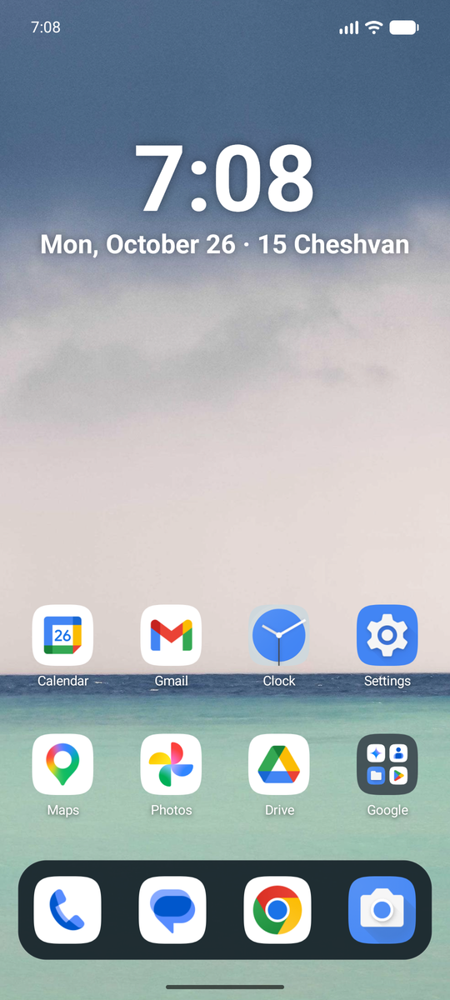
  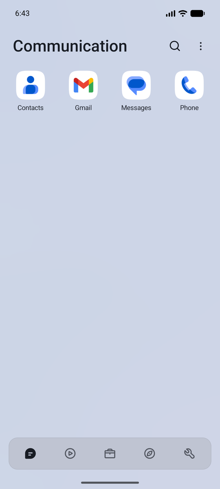
  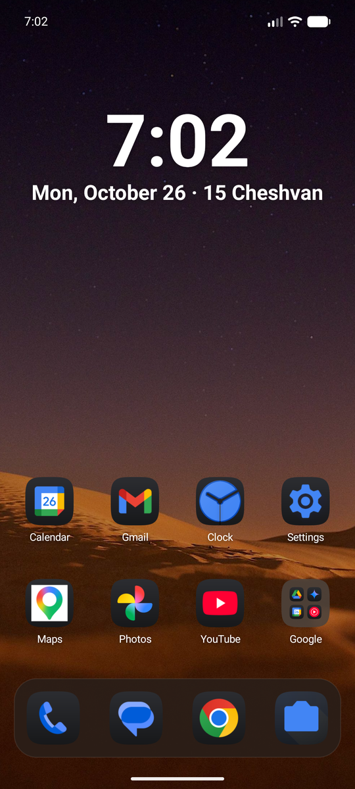
  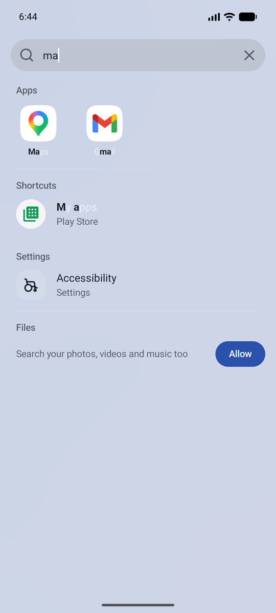
</p>

Plain Kotlin and platform Views, no AndroidX and no third-party libraries, so it opens instantly even on slow phones.

## What it does

**Home screen and app list**
- Pages, a dock, folders and widgets. Drag a widget over another and they swap places.
- A clock with the date, the Hebrew date and parsha, and under it the weather and what's coming up next.
- Widgets in Android's own style, colored from your wallpaper: Agenda, Weather, Now playing and Zmanim.
- A Jewish calendar (Yom Tov, fasts, Rosh Chodesh, the parsha, the Omer and Daf Yomi) and zmanim for your location.
- An app list grouped into categories (with tabs) or all at once (with category chips). Drag apps to reorder them or move them between categories.
- Hidden apps, kept on their own page behind an optional PIN.
- A red badge with the number of notifications an app has, as on iPhone (folders add up their apps'), and a dot on apps you've installed but haven't opened yet.
- Colors taken from your wallpaper, and an iOS-style dark mode: dark or tinted icons, a dimmed wallpaper, and an optional light and dark wallpaper pair that switches by itself.
- A built-in wallpaper picker: your photos, calm colors, and free photos from Unsplash photographers.

**Smart Search**
- Apps, contacts (any of their numbers), app shortcuts, phone settings and files, with T9 and letter matching.
- Settings → Search can place contacts and apps side by side. Tap or highlight a contact for its actions, or tap its picture to open its details; settings and files stay below.
- Type a number on the home screen to dial it; the Call key places the call.
- Optional search memory puts matching selections first within their category, most recent first. Turn it on or reset it in **Settings → Search**; saved selections are included in backups.

**Made for keypads**
- Every screen works with the arrow keys and OK, with a clear highlight. Hold OK on anything for its menu, and move icons, widgets, categories and apps with the arrows.
- Hold a number to open its app. Hold Up for search, Down for the app list, Left and Right for pages and categories.
- Key shortcuts: press, hold, double press or two keys together, in all apps, the home screen or one app. Open apps, call people, toggle the flashlight, switch keyboards and more.

**Calmer phone**
- **App limits:** block chosen apps or make them wait before opening, all day or between two times on the days you pick, however they're opened. Changing limits can need a wait, a PIN or a restart.
- **Notification filters:** hide notifications by app and by words or patterns, always or during an app limit, with a history of what was hidden.

## Screenshots

| Light and dark | | |
|---|---|---|
|  |  | 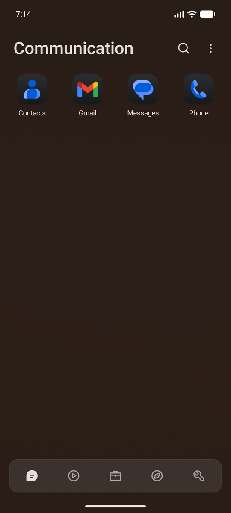 |
| Home screen, colors from your wallpaper | Dark mode: dark icons, the night wallpaper of a pair | App list in dark mode |

| Getting things done | | |
|---|---|---|
|  | 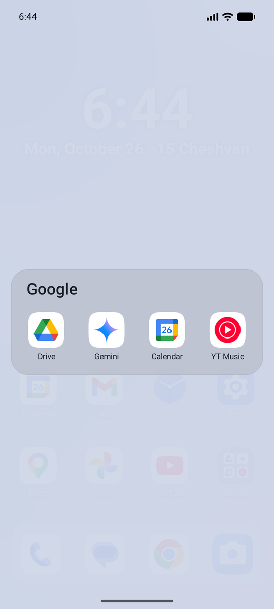 | 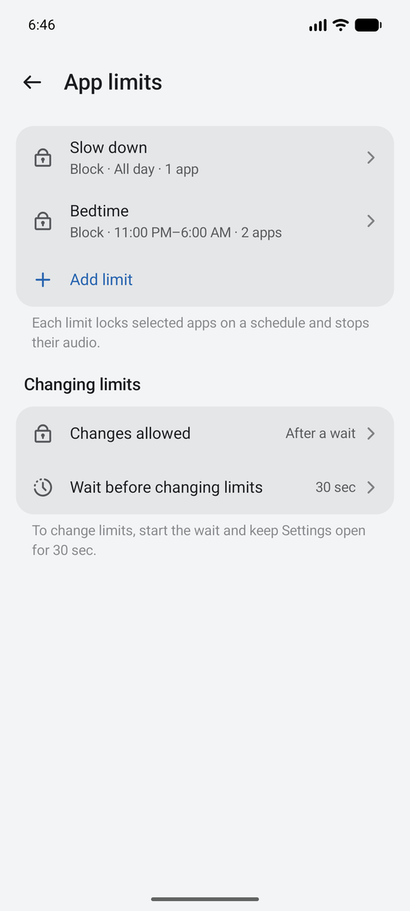 |
| Smart Search: apps, contacts, shortcuts, settings, files | Folders | App limits |

| Make it yours | | |
|---|---|---|
| 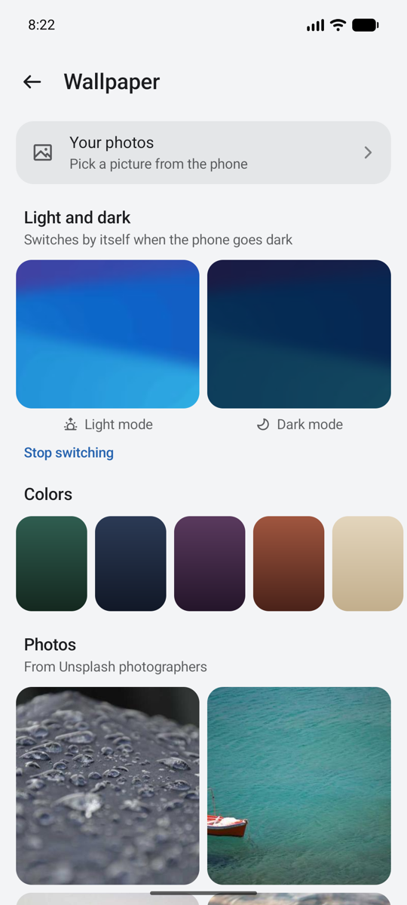 | 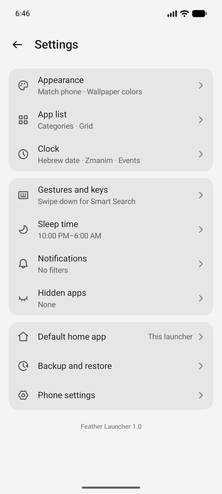 | 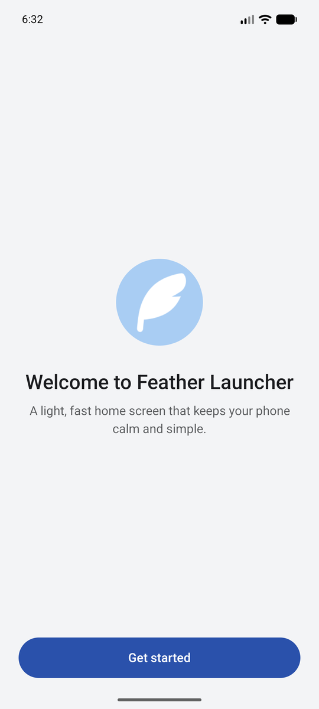 |
| Wallpapers, including light and dark pairs | Settings | A short welcome on first run |

**On a keypad phone** (480×640): type a number to dial or search, with T9.

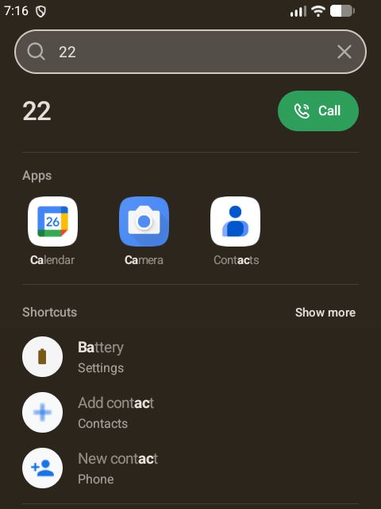

## Install

Download the APK from the releases page and install it, or build it yourself:

```sh
./gradlew :app:assembleRelease
adb install -r app/build/outputs/apk/release/app-release.apk
```

The first time it opens, a short welcome sets it as your home screen and lets you choose how apps are arranged. Other permissions are only asked for when you turn on the feature that needs them (accessibility for App limits and key shortcuts, notification access for filters, contacts for search). Everything is optional.

Requires Android 13 or later.

### Updates

Once a day the app checks this repository's latest release. When there's a newer version, a notification says so and **Settings → Updates** installs it: the app downloads the APK, checks it against the release's checksum, and hands it to Android, which only accepts it if it's signed with the same key. The first time, Android asks you to allow Feather Launcher to install apps.

To publish a release:

1. Raise `versionCode` and `versionName` in `app/build.gradle.kts`.
2. Build with `./gradlew :app:assembleRelease`, signed with the release key (`setup/keystore.properties`). Every release must use the same key, or phones can't update to it.
3. Create a GitHub release tagged `v` plus the version name (`v1.1`) and attach the APK as `FeatherLauncher-1.1.apk`.
4. Write the release notes as a changelog of what this version changed, not install steps (those are here): a sentence on what the release is about, then short plain items under **New**, **Changed** and **Fixed**, saying where to find new things (Settings → App limits), and a **Full changelog** link comparing with the last version. The app shows these notes on its update screen.

## Bringing in a setup

Categories, hidden apps, key shortcuts and notification filters can be loaded from a JSON file over adb, which is handy when setting up several phones the same way. See [`docs/setup-example.json`](docs/setup-example.json):

```sh
adb shell am broadcast -a app.featherlauncher.SETUP -n app.featherlauncher/.SetupImport \
    --es json64 "$(base64 < my-setup.json | tr -d '\n')"
```

Only adb can send it. Every part is optional: `categories` and `hidden` replace the app list layout, and `shortcuts` and `filters` are added to what's there.

## Design

- Flat and modern: no borders except a faint hairline on surfaces over the wallpaper, no card inside a card, rounded highlights, even padding, and corner radii that nest.
- Icons are [MingCute](https://github.com/Richard9394/MingCute) line icons (filled for selected states).
- Surfaces on the wallpaper take its color. Menus and sheets follow light or dark mode.
- Tapping moves, holding acts: on the keypad, holding a key never just moves the highlight.

## Code map

| File | What it does |
| --- | --- |
| `HomeActivity` | The home screen activity: panels (app list and Smart Search), keys, menus, app list drags |
| `HomeScreen`, `Workspace` | Pages, dock, widgets and folders, and how they're saved |
| `AppRepository`, `IconShape`, `IconLooks` | Installed apps and their icons, including dark and tinted icons |
| `Categories`, `Category` | App list categories |
| `SmartSearch`, `Search`, `Contacts`, `Shortcuts` | Search, with T9 |
| `Overlays`, `Components`, `Ui`, `Theme` | The design system: menus, sheets, rows, spacing, type and colors |
| `SettingsActivity` and `*Settings` | Settings pages |
| `LauncherService` | Accessibility service: App limits and key shortcuts |
| `AppLimits`, `LimitActivity`, `LimitSettings`, `MediaGuard` | App limits |
| `KeyShortcuts`, `KeyActionRunner` | Key shortcuts |
| `NotificationService`, `NotificationFilters` | Notification filters |
| `NotificationBadges`, `IconBadges` | Notification counts on app icons, and the other marks drawn on icons |
| `Updates` | Updates from GitHub releases |
| `ClockInfo`, `Glance`, `Zmanim`, `JewishCalendar`, `SecondCalendar` | The clock's lines, zmanim and calendars |
| `Widgets`, `WidgetView`, `FeatherWidgets`, `WidgetStyle`, `Weather` | Other apps' widgets, the widget list, and Feather's own widgets |
| `WallpaperActivity`, `DarkMode` | Wallpapers and dark mode |
| `Setup`, `SetupImport` | First-run checklist, and loading a setup over adb |

## License

GNU General Public License v3.0; see [LICENSE](LICENSE). You're free to use, change and share Feather Launcher, including your own versions, as long as they stay open source under the same license.

The [MingCute](https://github.com/Richard9394/MingCute) icons are under the Apache License 2.0 ([docs/MINGCUTE_LICENSE](docs/MINGCUTE_LICENSE)).
