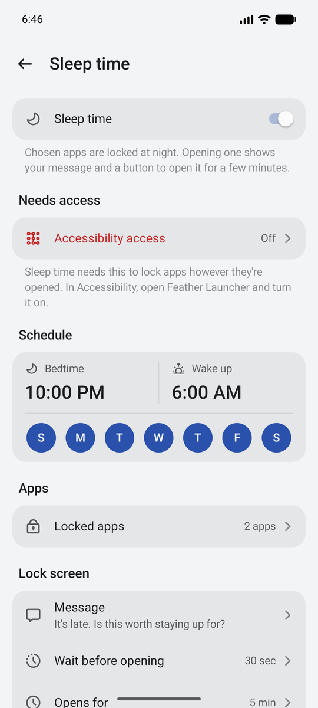

# Feather Launcher

A light, fast and beautiful Android home screen. It's a pleasure to use on any phone, and it's especially good on phones with a hardware number keypad (T9), where most launchers fall apart.


<p align="center">
  
  
  
  
</p>

Plain Kotlin and platform Views, no AndroidX and no third-party libraries, so it opens instantly even on slow phones.

## What it does

**Home screen and app list**
- Pages, a dock, folders, widgets, and a built-in clock with the Hebrew date, the next zman and your next calendar event.
- An app list grouped into categories (with tabs) or all at once (with category chips). Drag apps to reorder them or move them between categories.
- Hidden apps, kept on their own page behind an optional PIN.
- A dot on apps you've installed but haven't opened yet.
- Colors taken from your wallpaper, and an iOS-style dark mode: dark or tinted icons, a dimmed wallpaper, and an optional light and dark wallpaper pair that switches by itself.
- A built-in wallpaper picker: your photos, calm colors, and free photos from Unsplash photographers.

**Smart Search**
- Apps, contacts (any of their numbers), app shortcuts, phone settings and files, with T9 and letter matching.
- Type a number on the home screen to dial it; the Call key places the call.

**Made for keypads**
- Every screen works with the arrow keys and OK, with a clear highlight.
- Hold a number to open its app. Hold Up for search, Down for the app list, Left and Right for pages and categories.
- Key shortcuts: press, hold, double press or two keys together, in all apps, the home screen or one app. Open apps, call people, toggle the flashlight, switch keyboards and more.

**Calmer phone**
- **Sleep time:** at night, chosen apps lock however they're opened. Opening one needs a short wait, then it's open for a few minutes; its audio stops when time is up.
- **Notification filters:** hide notifications by app and by words or patterns, always or only at night, with a history of what was hidden.

## Screenshots

| Light and dark | | |
|---|---|---|
|  |  |  |
| Home screen, colors from your wallpaper | Dark mode: dark icons, the night wallpaper of a pair | App list in dark mode |

| Getting things done | | |
|---|---|---|
|  |  |  |
| Smart Search: apps, contacts, shortcuts, settings, files | Folders | Sleep time |

| Make it yours | | |
|---|---|---|
|  |  |  |
| Wallpapers, including light and dark pairs | Settings | A short welcome on first run |

**On a keypad phone** (480×640): type a number to dial or search, with T9.


## Install

Download the APK from the releases page and install it, or build it yourself:

```sh
./gradlew :app:assembleRelease
adb install -r app/build/outputs/apk/release/app-release.apk
```

The first time it opens, a short welcome sets it as your home screen and lets you choose how apps are arranged. Other permissions are only asked for when you turn on the feature that needs them (accessibility for Sleep time and key shortcuts, notification access for filters, contacts for search). Everything is optional.

Requires Android 13 or later.

## Bringing in a setup

Categories, hidden apps, key shortcuts and notification filters can be loaded from a JSON file over adb, which is handy when setting up several phones the same way. See [`docs/setup-example.json`](docs/setup-example.json):

```sh
adb shell am broadcast -a app.featherlauncher.SETUP -n app.featherlauncher/.SetupImport \
    --es json64 "$(base64 < my-setup.json | tr -d '\n')"
```

Only adb can send it. Every part is optional: `categories` and `hidden` replace the app list layout, and `shortcuts` and `filters` are added to what's there.

## Design

- Flat and modern: no borders except a faint hairline on surfaces over the wallpaper, no card inside a card, rounded highlights, even padding, and corner radii that nest.
- Icons are [MingCute](https://github.com/Richard9394/MingCute) line icons (filled for selected states).
- Surfaces on the wallpaper take its color. Menus and sheets follow light or dark mode.
- Tapping moves, holding acts: on the keypad, holding a key never just moves the highlight.

## Code map

| File | What it does |
| --- | --- |
| `HomeActivity` | The home screen activity: panels (app list and Smart Search), keys, menus, app list drags |
| `HomeScreen`, `Workspace` | Pages, dock, widgets and folders, and how they're saved |
| `AppRepository`, `IconShape`, `IconLooks` | Installed apps and their icons, including dark and tinted icons |
| `Categories`, `Category` | App list categories |
| `SmartSearch`, `Search`, `Contacts`, `Shortcuts` | Search, with T9 |
| `Overlays`, `Components`, `Ui`, `Theme` | The design system: menus, sheets, rows, spacing, type and colors |
| `SettingsActivity` and `*Settings` | Settings pages |
| `LauncherService` | Accessibility service: Sleep time and key shortcuts |
| `SleepTime`, `SleepActivity`, `MediaGuard` | Sleep time |
| `KeyShortcuts`, `KeyActionRunner` | Key shortcuts |
| `NotificationService`, `NotificationFilters` | Notification filters |
| `ClockInfo`, `Zmanim` | The clock's extra lines |
| `WallpaperActivity`, `DarkMode` | Wallpapers and dark mode |
| `Setup`, `SetupImport` | First-run checklist, and loading a setup over adb |

## License

GNU General Public License v3.0; see [LICENSE](LICENSE). You're free to use, change and share Feather Launcher, including your own versions, as long as they stay open source under the same license.

The [MingCute](https://github.com/Richard9394/MingCute) icons are under the Apache License 2.0 ([docs/MINGCUTE_LICENSE](docs/MINGCUTE_LICENSE)).
